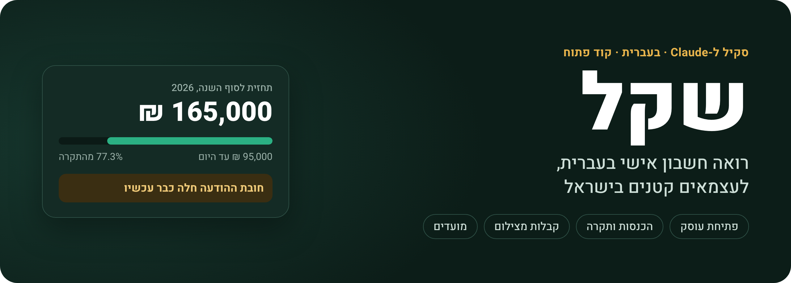
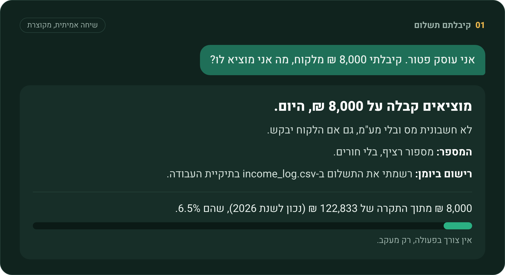
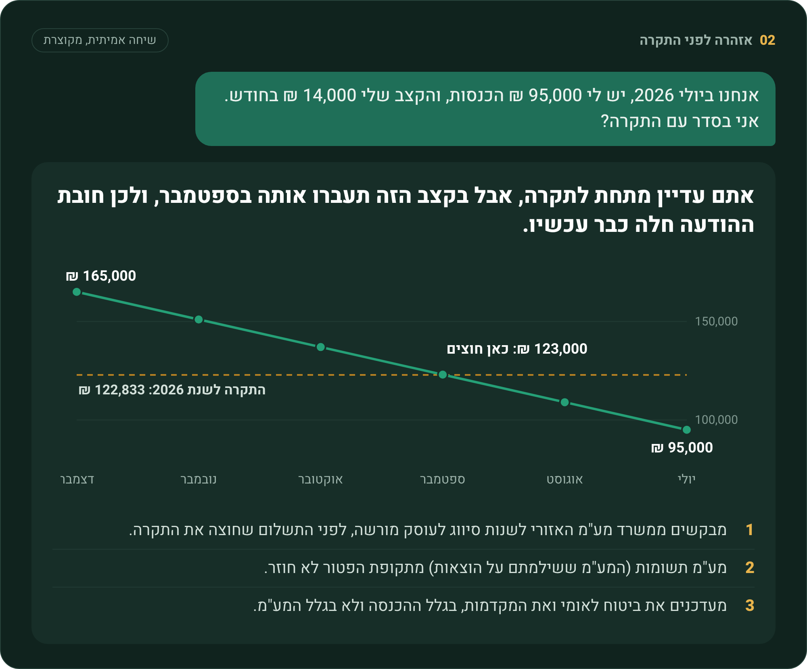
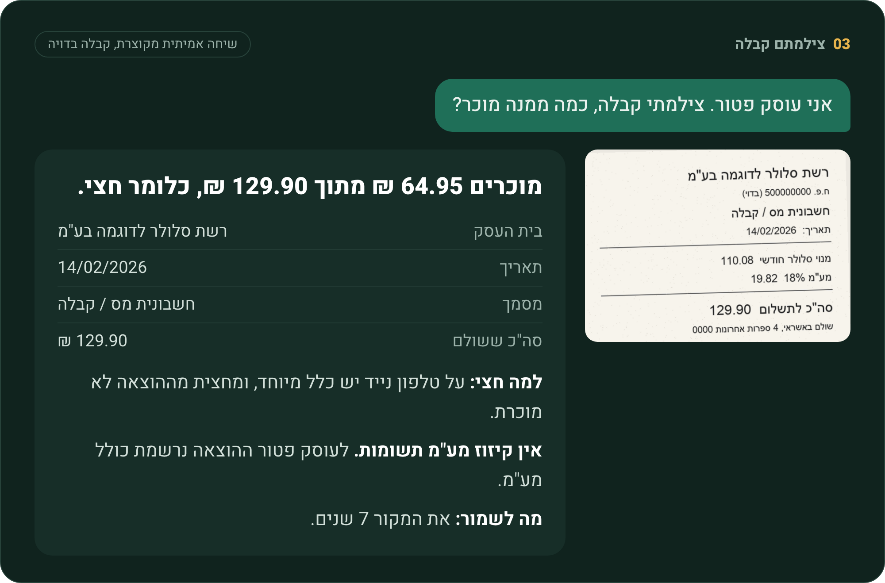
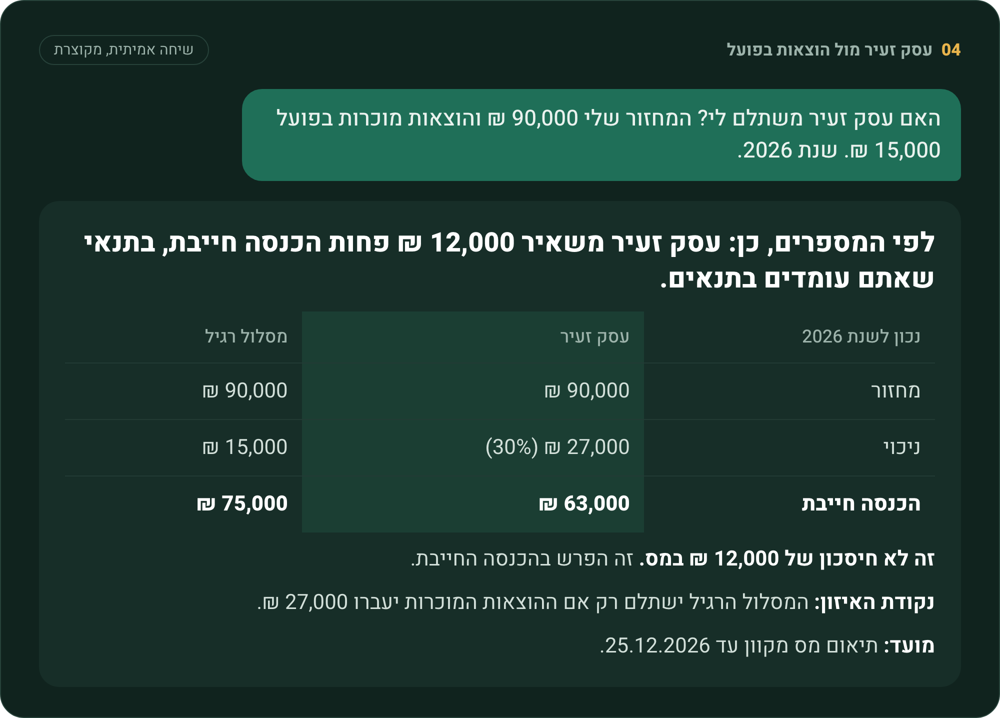
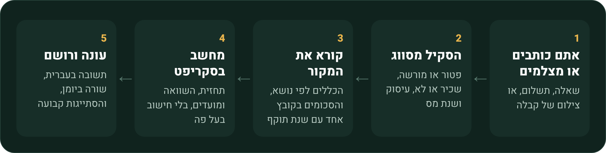

<div align="center">



<br>

[](LICENSE) [](https://claude.com/claude-code) [](scripts/) [](evidence.json) [](tests/)

</div>

<div dir="rtl">

<h3 align="center">כותבים בעברית. מצלמים קבלה. מקבלים תשובה עם מספרים, מקור ומה עושים עכשיו.</h3>

<p align="center">
<a href="#התקנה"><b>התקנה</b></a> &nbsp;·&nbsp;
<a href="#דוגמאות"><b>דוגמאות</b></a> &nbsp;·&nbsp;
<a href="#מה-הוא-יודע-לעשות"><b>יכולות</b></a> &nbsp;·&nbsp;
<a href="#למה-אפשר-לסמוך-על-המספרים"><b>אמינות</b></a> &nbsp;·&nbsp;
<a href="#שאלות-נפוצות"><b>שאלות נפוצות</b></a>
</p>

> [!IMPORTANT]
> **זה לא ייעוץ מס.** זו המחשה שעוזרת לכם להתארגן. החישוב המחייב הוא של רשות המסים, ובמקרה מורכב דברו עם רואה חשבון או יועץ מס.

## בקצרה

שקל הוא סקיל ל-Claude Code שמתנהג כמו חבר רואה חשבון: מדבר עברית פשוטה, אומר מה לעשות, ורושם בשבילכם. הוא נבנה לעוסק פטור, למי שרוצה לפתוח אחד, ולשכירים עם עסק צד.

| מצב | מה הוא עושה |
|---|---|
| **פותחים עוסק** | בודק אם מותר לכם להיות פטור, ונותן צ'קליסט למע"מ, מס הכנסה וביטוח לאומי, עם קישורים |
| **קיבלתם תשלום** | אומר איזה מסמך להוציא, רושם ביומן, ומראה איפה אתם מול התקרה |
| **צילמתם קבלה** | קורא את התמונה, אומר כמה מוכר ולמה, ומשווה למסלול 30% של עסק זעיר |
| **מתקרבים לתקרה** | מחשב תחזית לסוף השנה, ומזהיר לפני התשלום שחוצה |
| **מועדים** | לוח בתאריכים מדויקים, וקובץ לייבוא ליומן עם התראות |

## התקנה

**מה צריך:** [Claude Code](https://claude.com/claude-code). Python 3 מומלץ, בלי התקנות נוספות. הסקיל עובד גם בלעדיו, אבל החישובים מדויקים יותר דרך הסקריפטים.

### שלב 1: מתקינים

מריצים בטרמינל:

<div dir="ltr">

```bash
git clone https://github.com/Emet-afik/shekel ~/.claude/skills/shekel
```

</div>

או מדביקים את הקישור לריפו ב-Claude Code וכותבים **"תתקין"**.

### שלב 2: פותחים שיחה חדשה

הסקיל נטען אוטומטית כשכותבים על עוסק, קבלה, תקרה, ביטוח לאומי או דוח שנתי. לא צריך פקודה מיוחדת.

### שלב 3: בודקים שזה עובד

כותבים ל-Claude:

> מה המועדים שלי השנה? אני עוסק פטור.

אם חוזר לוח מועדים בתאריכים מדויקים, הכול מותקן.

<details>
<summary><b>התקנה לפרויקט אחד, עדכון והסרה</b></summary>

<br>

**רק לפרויקט אחד:**

<div dir="ltr">

```bash
git clone https://github.com/Emet-afik/shekel .claude/skills/shekel
```

</div>

**עדכון, למשל אחרי עדכון הסכומים בינואר:**

<div dir="ltr">

```bash
git -C ~/.claude/skills/shekel pull
```

</div>

**הסרה:**

<div dir="ltr">

```bash
rm -rf ~/.claude/skills/shekel
```

</div>

היומנים שלכם לא נמחקים, כי הם נשמרים בתיקיית העבודה ולא בתיקיית הסקיל.

</details>

## דוגמאות

כל הדוגמאות כאן הן שיחות אמיתיות מהרצת הבדיקות של הסקיל, מקוצרות לתמונה. התשובה המלאה נמצאת מתחת לכל תמונה. שמות הלקוחות והקבלה בדויים.

### קיבלתם תשלום



<details>
<summary><b>התשובה המלאה</b></summary>

<br>

**מוציאים קבלה על 8,000 ₪, היום.** לא חשבונית מס ובלי מע"מ, גם אם הלקוח יבקש. דוגמה בע"מ לא תקזז מע"מ על הקבלה הזו, וזה תקין.

#### מה כתוב בקבלה

**קבלה מספר:** [המספר הבא אחרי הקבלה הקודמת שלכם]<br>
**תאריך:** 1.11.2026

**מאת:** [השם שלכם]<br>
**מספר עוסק או ת"ז:** [מספר]

**התקבל מאת:** דוגמה בע"מ<br>
**כתובת:** [אם ידועה]

**סכום:** 8,000 ₪<br>
**עבור:** עיצוב אתר (או תיאור מדויק יותר של העבודה)<br>
**אופן התשלום:** [העברה / מזומן / אשראי / שיק]<br>
**פרטי שיק, אם יש:** [מספר, בנק וסניף, זמן פירעון]

**חתימה:** לא צריך אם הקבלה נשלחת כמסמך ממוחשב

#### שתי נקודות לבדיקה

- **המספר:** מספור רציף, בלי חורים. "התשלום הראשון השנה" לא אומר בהכרח קבלה מספר 1. אם כבר הוצאתם קבלות בעבר, ממשיכים מהמספר הבא. רק אם זו הקבלה הראשונה שלכם אי פעם, היא מספר 1. עותק אחד מהקבלה נשלח ללקוח.
- **ניכוי מס במקור:** הנחתי שהלקוח לא ניכה מס ושהסכום המלא הוא 8,000 ₪. אם 8,000 ₪ הוא מה שנכנס אחרי ניכוי, הקבלה היא על הסכום המלא לפני הניכוי. מה שנוכה הוא לא חוב של הלקוח, ובקשו ממנו אישור על הניכוי.

#### רישום ביומן

רשמתי את התשלום ב-`income_log.csv` בתיקיית העבודה. עמודות מספר הקבלה ואופן התשלום נשארו ריקות, ועדיין צריך להשלים אותן. כתבתי "עיצוב אתר" כתיאור העבודה, וכדאי לעדכן אם התיאור בקבלה שונה.

#### מצב מול התקרה

8,000 ₪ מתוך התקרה של 122,833 ₪ (נכון לשנת 2026), שהם 6.5%. התחזית לסוף השנה: 8,727 ₪.

אין צורך בפעולה, רק מעקב. התחזית נשענת על תשלום אחד בלבד. גם אם העסק נפתח רק החודש, והקצב הוא 8,000 ₪ בחודש, מגיעים ל-16,000 ₪, הרבה מתחת לתקרה. במקרה כזה, של פתיחה באמצע השנה, לא בדקנו אם התקרה יחסית, אז שאלו על זה רואה חשבון.

> זו המחשה שעוזרת לכם להתארגן, לא ייעוץ מס. החישוב המחייב הוא של רשות המסים, ובמקרה מורכב דברו עם רואה חשבון או יועץ מס.

</details>

### אזהרה לפני שעוברים את התקרה

לפי האחוז, 77% נראה נוח. לפי התחזית, צריך לפעול כבר עכשיו. זה בדיוק ההבדל.



<details>
<summary><b>התשובה המלאה</b></summary>

<br>

**לא. אתם עדיין מתחת לתקרה, אבל בקצב הזה תעברו אותה בספטמבר, ולכן חובת ההודעה חלה כבר עכשיו.** החובה נוצרת מהצפי ולא מהכסף שכבר נכנס.

#### המספרים

- **עד היום:** 95,000 ₪ מתוך התקרה של 122,833 ₪ (נכון לשנת 2026), שהם 77.3%.
- **תחזית לסוף השנה:** 165,000 ₪, כלומר 95,000 ₪ ועוד 5 חודשים של 14,000 ₪. זה 134.3% מהתקרה.
- **מתי חוצים:** נשארו לכם 27,833 ₪. אחרי אוגוסט תגיעו ל-109,000 ₪, ואחרי ספטמבר ל-123,000 ₪.
- **ההנחה:** ה-95,000 ₪ כוללים את כל התשלומים של יולי. אם לא, החצייה מוקדמת בחודש, כלומר באוגוסט.

התחזית קובעת, לא האחוז. 77% נראה נוח, אבל הוא לא זה שקובע כאן.

#### מה עושים עכשיו

1. **מבקשים ממשרד מע"מ האזורי לשנות סיווג לעוסק מורשה, לפני התשלום שחוצה את התקרה.** אל תחכו לספטמבר. יש טיוטה מוכנה ב-`templates/reclassification_letter.md`: מחזור עד היום 95,000 ₪, מחזור צפוי 165,000 ₪. לפני השליחה בדקו מול המשרד אם נדרש טופס מסוים (מוקד רשות המסים: ‎*4954).
2. **בודקים קניות גדולות לפני המעבר.** **מע"מ תשומות** (המע"מ ששילמתם על הוצאות) מתקופת הפטור לא חוזר. רק הוצאות מרגע המעבר מזכות בקיזוז, אז אם מתוכננת קנייה גדולה, עיתוי המעבר שווה כסף.
3. **מעדכנים את ביטוח לאומי ואת המקדמות למס הכנסה.** העדכון נדרש בגלל ההכנסה, לא בגלל המע"מ. המעבר עצמו לא מעלה ביטוח לאומי, אבל הכנסה גבוהה בלי עדכון יוצרת חוב. בביטוח לאומי אפשר לבקש תיקון מקדמות פעם ברבעון, אם ההכנסה השתנתה ב-10% לפחות.
4. **מדברים עם רואה חשבון על העיתוי.** אחרי המעבר תוציאו חשבוניות מס עם מע"מ, תדווחו למע"מ ותעדכנו את הלקוחות. רואה חשבון הוא גם הכתובת לשאלה מה קורה עם מע"מ על מחזור שמעל התקרה לפני שינוי הסיווג. המקורות שלי לא מכריעים בזה, אז אל תניחו שאין חשיפה.

**עסק זעיר לא פותר את זה:** התקרה זהה, והמעמד נגמר כשעוברים אותה.

#### מה יכול לשנות את התמונה

התחזית נשענת על הקצב שנתתם. אם באמת צפויים לכם פחות מ-27,833 ₪ עד סוף השנה, למשל כי העבודה נגמרת, החישוב משתנה. אז תספרו לי ונעשה אותו מחדש.

**מועד קרוב:** ב-22.7.2026 יש חיוב ביטוח לאומי בהוראת קבע, עבור חודש 6.

**שלוש שאלות שישפיעו על התכנון:**
- האם אתם רשומים כעסק זעיר?
- האם מתוכננת קנייה גדולה לעסק?
- האם הקצב של 14,000 ₪ יציב, או שיש חודשים חזקים וחלשים?

מידע נוסף: [כל-זכות, עוסק פטור](https://www.kolzchut.org.il/he/עוסק_פטור)

> זו המחשה שעוזרת לכם להתארגן, לא ייעוץ מס. החישוב המחייב הוא של רשות המסים, ובמקרה מורכב דברו עם רואה חשבון או יועץ מס.

</details>

### צילמתם קבלה



<details>
<summary><b>התשובה המלאה</b></summary>

<br>

**מוכרים 64.95 ₪ מתוך 129.90 ₪, כלומר חצי.** זה בהנחה שהטלפון משמש גם לעסק.

**מה קראתי בצילום** (אם משהו לא נכון, כתבו לי ואתקן):
- בית העסק: רשת סלולר לדוגמה בע"מ
- תאריך: 14/02/2026
- מסמך: חשבונית מס / קבלה
- פירוט: מנוי סלולר חודשי 110.08 ₪, מע"מ 19.82 ₪
- סה"כ ששולם: 129.90 ₪

**למה חצי:**
- על טלפון נייד יש כלל מיוחד (כלל הרצפה). סכום מסוים בשנה לא מוכר, והשאר כן.
- הסכום הלא מוכר הוא הנמוך מבין 1,380 ₪ בשנה (נתון לשנת המס 2024) לבין מחצית ההוצאה השנתית.
- החשבון שלכם בשנה: 129.90 × 12 = 1,558.80 ₪. המחצית היא 779.40 ₪, והיא נמוכה מ-1,380 ₪, ולכן מחצית לא מוכרת ומחצית מוכרת.

**שני דברים שכדאי לדעת:**
- **הסכום 1,380 ₪ הוא הנתון האחרון שמצאנו, של 2024.** בדקו באתר רשות המסים את הסכום של 2026. בחשבון בגודל הזה הוא כנראה לא ישנה את התוצאה, כל עוד הסכום המעודכן גבוה מ-779.40 ₪.
- **אם החשבון משתנה מחודש לחודש,** החישוב השנתי יהיה לפי מה ששילמתם בפועל, ולא לפי הכפלה ב-12.

**אין קיזוז מע"מ תשומות** (המע"מ ששילמתם על הוצאות). לעוסק פטור ההוצאה נרשמת כולל מע"מ, ולכן החצי מחושב על 129.90 ₪, ולא על 110.08 ₪.

**מה לשמור:** את המקור 7 שנים. הצילום הוא רק עותק עבודה. בצילום לא מופיע שם הלקוח, ולכן כדאי לוודא שהחשבון על שמכם. אם הוא על שם אחר, שאלו רואה חשבון.

**רישום:** ההוצאה נרשמה ביומן ב-`expense_log.csv`, בתיקיית העבודה, עם 64.95 ₪ כסכום מוכר.

> זו המחשה שעוזרת לכם להתארגן, לא ייעוץ מס. החישוב המחייב הוא של רשות המסים, ובמקרה מורכב דברו עם רואה חשבון או יועץ מס.

</details>

### עסק זעיר או מסלול רגיל



<details>
<summary><b>התשובה המלאה</b></summary>

<br>

**לפי המספרים, כן: מסלול עסק זעיר משאיר לכם 12,000 ₪ פחות הכנסה חייבת (הסכום שעליו מחושב המס), בתנאי שאתם עומדים בתנאים שלמטה.**

| נכון לשנת 2026 | עסק זעיר | מסלול רגיל |
|---|---|---|
| מחזור | 90,000 ₪ | 90,000 ₪ |
| ניכוי | 27,000 ₪ (30% מהמחזור, בלי קבלות) | 15,000 ₪ (הוצאות בפועל) |
| **הכנסה חייבת** | **63,000 ₪** | **75,000 ₪** |

- **זה לא חיסכון של 12,000 ₪ במס.** זה הפרש בהכנסה החייבת. כמה תחסכו בפועל תלוי בשאר המצב שלכם, למשל שכר במקביל. החישוב המחייב הוא של רשות המסים.
- **נקודת האיזון:** המסלול הרגיל ישתלם רק אם ההוצאות המוכרות יעברו 27,000 ₪, כלומר עוד 12,000 ₪ מעבר למה שיש לכם היום. אם המחזור ישתנה, גם הסכום הזה ישתנה.
- **הנחה שלי:** 15,000 ₪ הם רק הוצאות מוכרות, אחרי שהורדתם חלקים לא מוכרים כמו החלק הפרטי של הטלפון או אירוח לקוחות בארץ. אם לא, הפער לטובת עסק זעיר גדול עוד יותר.

**מה עוד מרוויחים ומה לא:**
- בדרך כלל אין מקדמות למס הכנסה, ומגישים דוח מקוצר במקום דוח שנתי מלא.
- ביטוח לאומי ממשיך כרגיל.
- זה מסלול של מס הכנסה בלבד, ולא מחליף מעבר לעוסק מורשה. המחזור שלכם הוא בערך 73% מהתקרה של 122,833 ₪ (נכון לשנת 2026), אז כרגע אתם מתחתיה. אם התחזית תעבור אותה, חובת המעבר תחול גם על עסק זעיר.

**לא תוכלו להיות עסק זעיר אם אחד מאלה נכון לגביכם:**
- אתם מעסיקים עובדים.
- אתם לא מנהלים פנקסים קבילים.
- ההכנסה לא מיגיעה אישית.
- הייתה לכם השנה הכנסה מהמעסיק שלכם, כלומר אתם שכירים ועובדים כעצמאים גם עבורו.
- ההכנסה מגיעה מתאגיד שקוף.
- יותר מ-25% מההכנסה מגיעים מקרוב, או ממעסיק של שלוש השנים הקודמות.
- אתם בעלי שליטה בחברת מעטים.

**מועדים:**
- **25.12.2026:** תיאום מס מקוון.
- **31.3.2027:** דוח מקוצר על שנת 2026. מי שלא מגיש עובר להיות עסק רגיל, עם דוח שנתי מלא.

אם אתם כבר רשומים ועדיין לא עסק זעיר, עושים את זה בבקשה מקוונת לשינוי סוג התיק. בדקו ברשות המסים או מול רואה חשבון איך זה חל על שנת 2026, כשהשנה כבר בסופה. המשיכו לשמור קבלות ולעקוב אחרי ההוצאות, כדי שתוכלו להשוות שוב.

**כדי לוודא שהמסקנה נכונה לכם, ענו על שלוש שאלות:**
1. האם אתם רשומים כבר כעסק זעיר, ואתם עוסק פטור או מורשה?
2. האם אתם שכירים במקביל, ואם כן, האם אתם עובדים גם עבור המעסיק שלכם?
3. האם אחד התנאים הפוסלים שברשימה חל עליכם?

> זו המחשה שעוזרת לכם להתארגן, לא ייעוץ מס. החישוב המחייב הוא של רשות המסים, ובמקרה מורכב דברו עם רואה חשבון או יועץ מס.

</details>

## מה לכתוב לו

| מצב | מה כותבים |
|---|---|
| רוצים להתחיל | אני רוצה לפתוח עוסק פטור, מה עושים? |
| שכירים עם עסק צד | אני שכיר ורוצה לעבוד גם כעצמאי, מה זה אומר לגבי ביטוח לאומי? |
| קיבלתם כסף | קיבלתי 8,000 ₪ מלקוח, מה אני מוציא לו? |
| הלקוח ניכה מס | לקוח שילם לי פחות כי ניכה מס במקור, מה רושמים? |
| קבלה | צילמתי קבלה, כמה ממנה מוכר? |
| תקרה | אני ב-95,000 ₪ ביולי, אני בסדר? |
| מסלול | האם עסק זעיר משתלם לי? |
| מועדים | מה המועדים שלי השנה? תכין לי קובץ ליומן |
| סוף שנה | תכין לי סיכום שנתי לרואה החשבון |

## מה הוא יודע לעשות

### פתיחת עוסק

בודק את העיסוק מול רשימת תקנה 13. רופאה, עורך דין או מהנדס לא יכולים להיות פטורים, והוא אומר את זה ישר. אחרי זה: צ'קליסט בשלושה חלקים, הסבר על המינימום בביטוח לאומי ולמה רישום מאוחר מסוכן, והסבר על עסק זעיר.

### הכנסות

אומר מה להוציא על כל תשלום: קבלה, חשבונית עסקה לפני התשלום, ואף פעם לא חשבונית מס לעוסק פטור. מזכיר מספור רציף, רושם ביומן, ומטפל בניכוי במקור כניכוי ולא כחוב. אחרי כל רישום מוצגת שורת מצב מול התקרה.

### תקרה ותחזית

התחזית קובעת, לא האחוז. לכל חודש שנשאר נלקח הגבוה מבין החוזה הצפוי לבין הקצב הרץ, ופרויקט חד-פעמי מתווסף מעל. כשהתחזית עוברת את התקרה, הוא אומר שחובת ההודעה כבר חלה, ומסביר את שתי המלכודות: לפעול לפני התשלום שחוצה, ושמע"מ תשומות מתקופת הפטור לא חוזר.

### הוצאות

קורא צילום של קבלה, מציג מה הבין, ומסווג: טלפון נייד לפי כלל הרצפה, בית ואינטרנט לפי חלק יחסי, רכב לפי הכלל, ציוד כפחת, ואירוח לקוח בארץ לא מוכר.

### מועדים ודוח שנתי

לוח שנה בתאריכים מדויקים, כולל הזזה משבת לראשון, ו"טרם פורסם" כשאין מועד רשמי. אפשר לייצא קובץ `.ics` עם התראה 3 ימים לפני כל מועד. בסוף השנה הוא ממלא דף סיכום לרואה החשבון.

## איך זה עובד



<div dir="ltr">

```text
shekel/
├── SKILL.md            the skill itself, in Hebrew
├── references/         rules by topic, all amounts in figures.md
├── templates/          checklist, receipt, invoice, logs, year summary, letter
├── scripts/            threshold, esek zair, deadlines, deductible share
├── evidence.json       source, quote and date for every number
└── tests/              35 unit tests and 9 scenarios
```

</div>

## למה אפשר לסמוך על המספרים

| עיקרון | מה זה אומר בפועל |
|---|---|
| **94 רשומות ראיה** | כל מספר, מועד וטופס ב-`SKILL.md` וב-`references` מופיע ב-[`evidence.json`](evidence.json), עם מקור, ציטוט ותאריך אימות |
| **ציטוטים נבדקו אוטומטית** | ציטוטי האתרים הושוו מילה במילה לטקסט שהורד מהמקור |
| **שנת תוקף לכל סכום** | כל הסכומים בקובץ אחד, [`figures.md`](references/figures.md), והסקריפטים קוראים ממנו |
| **בלי סכומים מהזיכרון** | אין מקור למספר? הוא לא נכנס, והסקיל מפנה לרשות המסים |
| **בדיקות אמיתיות** | 35 בדיקות יחידה, ותשעה תרחישים שרצו דרך `claude -p`, כולל צילום קבלה |

הנתונים אומתו ב-1.11.2026. הסכומים של טלפון נייד ומתנות הם של שנת המס 2024, כי לא נמצא נתון מאוחר יותר, והסקיל אומר את זה למשתמש.

<details>
<summary><b>להריץ את הבדיקות בעצמכם</b></summary>

<br>

<div dir="ltr">

```bash
./scripts/validate.sh              # structure, length, every number against the evidence
python3 tests/run_scenarios.py     # the nine scenarios through claude -p
```

</div>

</details>

## מה הוא לא עושה

- לא מגיש דוחות בשמכם, ולא מחליף רואה חשבון.
- לא מיועד לחברות או לשכר עובדים. עוסק מורשה מקבל עזרה בסיסית.
- לא שולח הודעות בעצמו. התזכורות מגיעות מקובץ היומן, ובכל שיחה הוא מזכיר מועד קרוב.
- לא מכיר חגים ודחיות חד-פעמיות בלוח. הוא מזהיר על כך, ומפנה לבדיקה באתר רשות המסים.
- לא מבטיח תוצאה. מודל בינה מלאכותית עלול לטעות, והאחריות לדיווח היא שלכם.

**מתי כדאי רואה חשבון:** עוסק מורשה עם מחזור גדול, עובדים, שאלות של תושבות, הצהרת הון.

## שאלות נפוצות

<details>
<summary><b>איפה נשמרים הנתונים שלי?</b></summary>

<br>

בתיקייה שבה פתחתם את Claude, בקבצים `income_log.csv` ו-`expense_log.csv`. הסקיל לא כותב לתיקייה שלו ולא שולח אותם לשירות נוסף. התוכן של השיחה עובר דרך Claude כמו כל שיחה אחרת.

</details>

<details>
<summary><b>מה קורה בינואר, כשהסכומים משתנים?</b></summary>

<br>

מוסיפים שורה עם השנה החדשה ב-[`references/figures.md`](references/figures.md), מעדכנים את `evidence.json` ומריצים `./scripts/validate.sh`. אם אין שורה לשנה שביקשתם, הסקיל אומר שהנתון עדיין לא הוזן ולא מנחש.

</details>

<details>
<summary><b>אני שכיר. זה מתאים לי?</b></summary>

<br>

כן. הסקיל שואל על שעות והכנסה צפויה, מסביר ביטוח לאומי לשכיר-עצמאי, ובודק אם אתם עובדים גם עבור המעסיק שלכם, כי זה פוסל עסק זעיר.

</details>

<details>
<summary><b>זה עובד בלי Python?</b></summary>

<br>

כן, הכללים והחישובים כתובים גם במילים, ו-Claude יכול לחשב לפי אותן נוסחאות. עם Python החישוב דטרמיניסטי, ולכן עדיף.

</details>

<details>
<summary><b>אפשר לתרום או לתקן נתון?</b></summary>

<br>

כן. פתחו issue או pull request עם קישור למקור. שינוי בלי מקור לא ייכנס.

</details>

## קרדיט ורישיון

מבוסס על סקילי המס והחשבונאות של [Skills IL](https://github.com/skills-il), רישיון MIT, עם שיפורים. מה שונה מהמקור מפורט ב-[`CHANGELOG.md`](CHANGELOG.md).

רישיון [MIT](LICENSE). נתונים מ[כל-זכות](https://www.kolzchut.org.il), רשות המסים, המוסד לביטוח לאומי ונוסחי החוק. הכלי אינו קשור לגופים האלה.

---

<sub>זו המחשה שעוזרת לכם להתארגן, לא ייעוץ מס. החישוב המחייב הוא של רשות המסים, ובמקרה מורכב דברו עם רואה חשבון או יועץ מס. הכלי פועל באמצעות מודל בינה מלאכותית, בלי בדיקה של רואה חשבון, והוא עלול לטעות. האחריות לדיווח היא שלכם.</sub>

</div>
